# AutoReparos.Cobranca — Orçamento, Pagamento e Mercado Pago

[](https://github.com/Grupo78-PosTech-15SOAT/AutoReparos.Cobranca/actions/workflows/ci-cd.yml)
[](https://sonarcloud.io/project/overview?id=Grupo78-PosTech-15SOAT_AutoReparos.Cobranca)
[](https://sonarcloud.io/component_measures?id=Grupo78-PosTech-15SOAT_AutoReparos.Cobranca&metric=coverage)


> **Tech Challenge FIAP SOAT — Fase 4 (Grupo 78).** Microsserviço de orçamento e pagamento (o *Billing Service* do enunciado): monta o orçamento com preços do catálogo da Execução, registra a aprovação do cliente, cobra pelo **Mercado Pago Checkout Pro**, valida e aplica o **webhook** de pagamento e participa da **Saga orquestrada pelo OS** por mensagens SQS.

| Em números | |
| --- | --- |
| Rotas REST | 6 (mais `GET /health`) |
| Mensagens publicadas para a Saga | 4 tipos `*.v1` |
| Comandos consumidos da Saga | 1 tipo (`cobranca.cancelar-orcamento.v1`, mais o alias legado) |
| Testes no CI (último run da `main`) | 111 |
| Cobertura de linhas no CI | **95,65%** (mínimo exigido: 80%) |

## Sumário

1. [Visão geral](#visão-geral)
2. [Arquitetura do serviço](#arquitetura-do-serviço)
3. [API REST](#api-rest)
4. [Papel na Saga](#papel-na-saga)
5. [Integração com o Mercado Pago](#integração-com-o-mercado-pago)
6. [Mensageria](#mensageria)
7. [Banco de dados](#banco-de-dados)
8. [Observabilidade](#observabilidade)
9. [Como rodar localmente](#como-rodar-localmente)
10. [Testes](#testes)
11. [Cobertura e qualidade](#cobertura-e-qualidade)
12. [CI/CD e deploy](#cicd-e-deploy)
13. [Configuração](#configuração)
14. [Repositórios do projeto](#repositórios-do-projeto)

---

## Visão geral

A Cobrança é um dos quatro microsserviços da Fase 4 (Cadastros, OS, **Cobrança** e Execução), com repositório, banco PostgreSQL, chart Helm, Terraform e pipeline próprios.

| Responsabilidade | Como |
| --- | --- |
| **Orçamento** | Cria um orçamento por OS, com valor informado ou com itens (serviços e insumos) cujos preços são lidos do catálogo da Execução e congelados no orçamento |
| **Aprovação** | O cliente aprova o próprio orçamento; a aprovação cria o pagamento e publica `orcamento.aprovado.v1` para a Saga |
| **Pagamento** | Abre o Checkout Pro só com o orçamento aprovado e a OS `Concluida` (pagamento depois do serviço e antes da entrega, D-09) |
| **Webhook** | Valida a assinatura da notificação, consulta o estado oficial do pagamento no Mercado Pago e publica `pagamento.resultado.v1` |
| **Compensação** | Cancela o orçamento quando a Saga pede (`cobranca.cancelar-orcamento.v1`), **sem nunca estornar** |
| **Reembolso** | Reembolso total ou parcial só com aprovação de um administrador, registrado e idempotente |

O que a Cobrança **não** faz: não orquestra o fluxo (o OS é o orquestrador), não altera o status da OS diretamente (a Saga faz isso ao receber `pagamento.resultado.v1`), não trata dados de cartão (ficam no Mercado Pago) e **não acessa o banco de nenhum outro serviço**.

### Papel no ecossistema

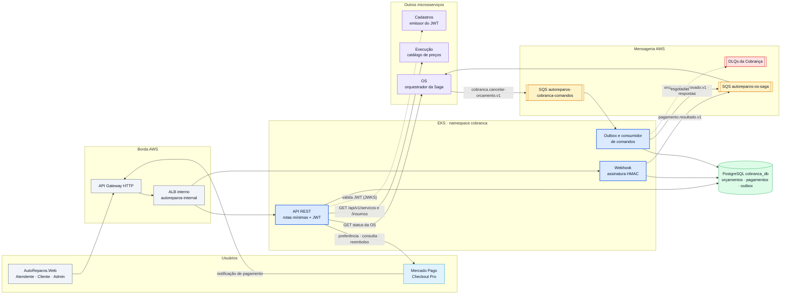

Em produção (`us-east-1`, cluster EKS `AutoReparosEKS`) as rotas públicas da Cobrança ficam atrás do API Gateway `https://8afyzjqfk2.execute-api.us-east-1.amazonaws.com`, inclusive o webhook `/api/v1/webhooks/mercado-pago` cadastrado no painel do Mercado Pago (evento Pagamentos).

---

## Arquitetura do serviço

Clean Architecture em quatro projetos (solução `AutoReparos.Cobranca.slnx`, .NET 10). O nome técnico interno `Billing` permanece em alguns tipos (`BillingService`, `BillingDbContext`) e na connection string `ConnectionStrings__Billing`.

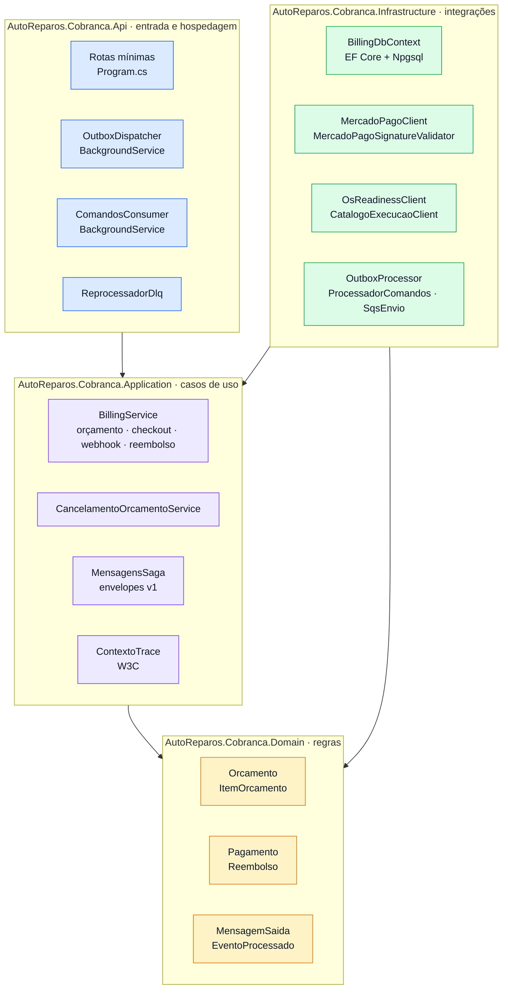

| Projeto | Responsabilidade | Principais arquivos |
| --- | --- | --- |
| `AutoReparos.Cobranca.Domain` | Orçamento e itens com preço congelado, pagamento e suas transições, reembolso, registros de outbox e inbox | `Orcamento.cs`, `ItemOrcamento.cs`, `Pagamento.cs`, `Reembolso.cs`, `Mensageria.cs` |
| `AutoReparos.Cobranca.Application` | `BillingService`, contratos e portas (`ICheckoutProvider`, `IOrderReadiness`, `ICatalogoPrecos`), envelopes da Saga, cancelamento por comando, trace W3C | `Contratos.cs`, `Mensageria.cs`, `ContextoTrace.cs` |
| `AutoReparos.Cobranca.Infrastructure` | EF Core/PostgreSQL e migrations, cliente do Mercado Pago, validador de assinatura, clientes HTTP do OS e da Execução, publicação SQS com retry e DLQ | `BillingDbContext.cs`, `Integracoes.cs`, `Mensageria.cs`, `Migrations/` |
| `AutoReparos.Cobranca.Api` | Rotas mínimas, JWT e políticas por papel, despachador de outbox, consumidor de comandos, reprocessador de DLQ, OpenTelemetry, modo migrar-e-sair | `Program.cs`, `ServicosMensageria.cs`, `ReprocessadorDlq.cs`, `MigracaoBancoDados.cs` |

```text
AutoReparos.Cobranca/
├── AutoReparos.Cobranca.Api/             # host ASP.NET Core: rotas, JWT, hosted services, OTel
├── AutoReparos.Cobranca.Application/     # BillingService, contratos, envelopes da Saga
├── AutoReparos.Cobranca.Domain/          # Orcamento, Pagamento, Reembolso, outbox/inbox
├── AutoReparos.Cobranca.Infrastructure/  # EF Core, Mercado Pago, clientes HTTP, SQS, migrations
├── AutoReparos.Cobranca.Tests/           # xUnit: unitários e integração (Testcontainers)
├── deploy/helm/cobranca/                 # chart Helm do serviço
├── infra/terraform/                      # ECR, filas SQS e DLQs, IRSA, segredo da database
├── postman/                              # collection das rotas
├── Dockerfile
└── .github/workflows/ci-cd.yml           # build → test → quality → deploy
```

### Decisões que moldam o serviço

| Decisão | O que foi decidido | Onde aparece no código |
| --- | --- | --- |
| D-07 | Saga orquestrada pelo OS; a Cobrança é participante e só fala com ela por mensagens | `MensagensSaga`, `CancelamentoOrcamentoService` |
| D-09 | Pagamento depois da conclusão e antes da entrega; sem expiração automática, **sem estorno automático**; reembolso só com aprovação | `BillingService.AbrirCheckoutAsync`, `Orcamento.PodeCancelar`, rota de reembolso |
| D-10 / D-62 | Mercado Pago **Checkout Pro** (API de Preferences) com webhook validado; credenciais de teste no SSM → Environment `production` → Secret do Kubernetes | `MercadoPagoClient`, `MercadoPagoSignatureValidator`, `ci-cd.yml` |
| D-32 | `orcamento.aprovado.v1` leva os insumos do orçamento (`itens`) para a reserva | `MensagensSaga.OrcamentoAprovado` |
| D-08 | Outbox (`mensagens_saida`), Inbox (`eventos_processados`) e retry próprio sobre `AWSSDK.SQS`, sem MassTransit | `OutboxProcessor`, `ProcessadorComandos`, `SqsEnvio` |
| D-24 | Comando em português `cobranca.cancelar-orcamento.v1`, aceitando o alias legado `billing.orcamento.cancelar.v1` na entrada | `TiposMensagem.EhCancelamentoOrcamento` |
| D-58 / D-64 | Token de serviço para chamar OS e Execução; claim `clienteId` no JWT do cliente | `OsReadinessClient`, `CatalogoExecucaoClient`, rotas de aprovação e checkout |
| D-42 / D-43 / D-47 | Terraform e chart no próprio repositório; migrations por Job Helm `pre-install,pre-upgrade` | `infra/terraform/`, `deploy/helm/cobranca/` |

O registro completo de decisões está no [índice da especificação da Fase 4](https://github.com/Grupo78-PosTech-15SOAT/AutoReparos/blob/main/.specs/features/fase4/especificacao/index.md) do repositório principal.

---

## API REST

As rotas de negócio exigem JWT emitido pelo Cadastros (`Authentication__Authority`, audiência `autoreparos`); o webhook é anônimo e protegido pela assinatura do Mercado Pago. Políticas definidas em `Program.cs`:

| Política | Papéis aceitos |
| --- | --- |
| `OperarBilling` | `Administrador`, `Atendente`, `ServicoOS` |
| `AprovarOrcamento` | `Cliente` (o claim `clienteId` precisa ser o dono do orçamento) |
| `IniciarCheckout` | `Administrador`, `Atendente`, `Mecanico`, `ServicoOS`, `Cliente` (cliente só do próprio orçamento) |
| `AprovarReembolso` / `AdministrarDlq` | `Administrador` |

| Verbo | Rota | Autorização | O que faz | Respostas |
| --- | --- | --- | --- | --- |
| `GET` | `/health` | anônima | Health check com verificação da database | `200`, `503` |
| `POST` | `/api/v1/orcamentos` | `OperarBilling` | Cria o orçamento da OS (`ordemServicoId`, `clienteId` e `valor` **ou** `itens` `{tipo: servico\|insumo, referenciaId, quantidade}`); um orçamento por OS (repetir devolve o existente) | `201`, `422`, `503` |
| `POST` | `/api/v1/orcamentos/{id}/aprovacao` | `AprovarOrcamento` | O cliente aprova; cria o pagamento e grava `orcamento.aprovado.v1` no outbox | `200`, `403`, `404`, `409` |
| `POST` | `/api/v1/pagamentos/{id}/checkout` | `IniciarCheckout` | Abre (ou devolve, se já pendente) o Checkout Pro e retorna `urlCheckout` | `200`, `403`, `404`, `409`, `502`, `503` |
| `POST` | `/api/v1/pagamentos/{id}/reembolsos` | `AprovarReembolso` | Reembolso total ou parcial aprovado por administrador (`valor`, `referencia`) | `201`, `404`, `409`, `422`, `502` |
| `POST` | `/api/v1/webhooks/mercado-pago` | anônima + assinatura `x-signature` | Notificação de pagamento do Mercado Pago | `202`, `401`, `422`, `503` |
| `POST` | `/api/v1/admin/dlq/reprocessar` | `AdministrarDlq` | Devolve até `quantidade` (1 a 100) mensagens das DLQs da Cobrança às filas de origem | `202`, `422` |

Códigos de erro estáveis (campo `codigo`): `orcamento_invalido`, `item_catalogo_inexistente`, `transicao_invalida`, `checkout_indisponivel`, `reembolso_invalido`, `reembolso_indisponivel`, `reembolso_recusado_provedor`, `webhook_invalido`, `pagamento_provedor_invalido`, `pagamento_desconhecido`, `resultado_nao_publicado`, `quantidade_invalida`; e, de forma transversal, `dependencia_indisponivel` (`503`, OS, Execução ou Mercado Pago fora do ar após as retentativas), `resposta_provedor_invalida` (`502`) e `conflito_concorrencia` (`409`, controle otimista por `xmin`).

**Exposição.** O Ingress do chart publica no ALB interno (e daí no API Gateway) os prefixos `/api/v1/orcamentos`, `/api/v1/pagamentos` e `/api/v1/webhooks/mercado-pago`. A rota `/api/v1/admin/dlq/reprocessar` não está entre os prefixos do Ingress: é usada de dentro do cluster.

**Contrato e documentação.** A collection [`postman/AutoReparos.Cobranca.postman_collection.json`](postman/AutoReparos.Cobranca.postman_collection.json) cobre todas as rotas acima (variáveis `baseUrl`, `token` e `id`). O documento OpenAPI (`/openapi/v1.json`) é publicado apenas no ambiente `Development`.

---

## Papel na Saga

A Saga do ciclo da OS é **orquestrada pelo OS Service** (D-07): ele guarda o estado no DynamoDB, decide cada passo e envia comandos. A Cobrança é **participante** — nunca lê o estado da Saga nem o banco do OS; recebe comandos na própria fila e publica eventos na fila de entrada da Saga (`autoreparos-os-saga`).

| Momento da Saga | O que a Cobrança faz | Mensagem |
| --- | --- | --- |
| **Início** (etapa 1, "Orçamento aprovado") | Ao aprovar, grava o evento no outbox na mesma transação; o despachador publica | publica `orcamento.aprovado.v1` (`orcamentoId`, `clienteId`, `itens`) |
| **Pagamento** (etapa 4, "Pagamento capturado") | Ao aplicar o webhook, publica o novo estado do pagamento; `Capturado` leva a Saga a `PagamentoCapturado` e a OS a `Paga` | publica `pagamento.resultado.v1` (`pagamentoId`, `status`, `referencia`) |
| **Compensação da etapa 1** | Cancela o orçamento se ainda não houve cobrança; senão recusa | consome `cobranca.cancelar-orcamento.v1`; responde `orcamento.cancelado.v1` ou `orcamento.cancelamento-recusado.v1` |

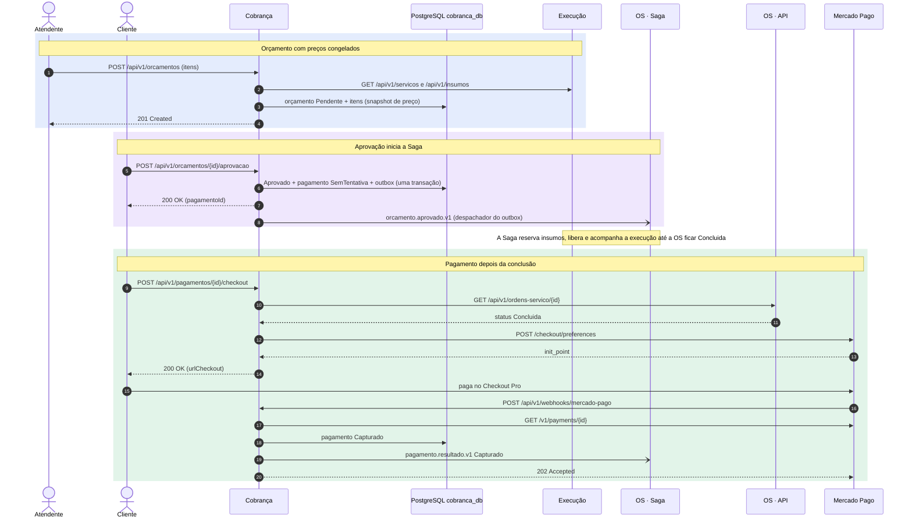

### Compensação: cancelar o orçamento

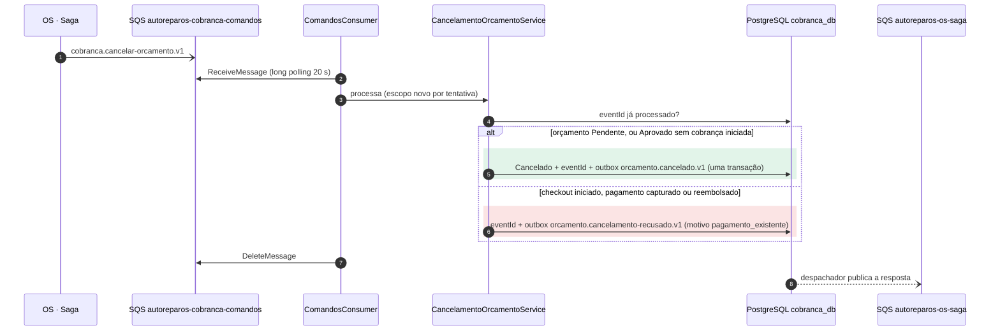

- **Nunca há estorno:** nenhum caminho de cancelamento chama o Mercado Pago. Se já existe tentativa de pagamento, a resposta é a recusa e a Saga vai a `CompensacaoFalhou`, que exige intervenção humana.
- **Idempotência:** o `eventId` do comando vai para `eventos_processados` na mesma transação do efeito e da resposta; uma entrega repetida, inclusive concorrente, não repete nada. Cancelar um orçamento já `Cancelado` confirma de novo. Os `eventId` das respostas são determinísticos (derivados do comando).
- **Mensagem inválida:** tipo desconhecido, `eventId` ausente, orçamento inexistente ou `ordemServicoId` divergente geram alerta (`billing.comando.tipo_desconhecido`, `billing.comando.malformado`, `billing.comando.orcamento_inexistente`, `billing.comando.ordem_divergente`) e a resposta `orcamento.cancelamento-recusado.v1`. Sem `orcamentoId` e `ordemServicoId` válidos não há a quem responder: alerta `billing.comando.malformado` e a mensagem vai à DLQ de comandos.

### Estados do orçamento e do pagamento

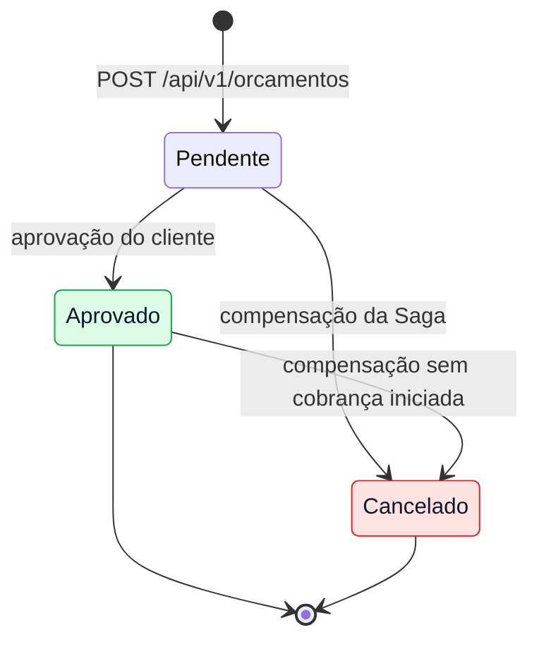

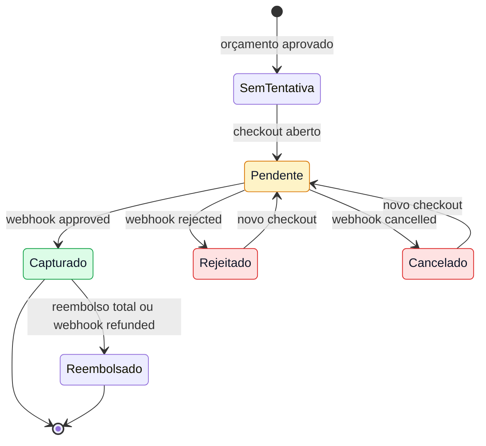

O enum de status do orçamento também tem `Recusado` e o de pagamento tem `Expirado`; nenhum caminho atual os aplica (não há rota de recusa e o mapeamento do Mercado Pago não produz `Expirado`). `Capturado` e `Reembolsado` são terminais: um webhook posterior com outro estado é rejeitado (`422 transicao_invalida`).

---

## Integração com o Mercado Pago

| Operação | Chamada | Detalhes |
| --- | --- | --- |
| Abrir checkout | `POST https://api.mercadopago.com/checkout/preferences` | `external_reference` = id do pagamento, item único "Serviço automotivo" em BRL, `X-Idempotency-Key` `checkout-{pagamento}-{tentativa}`; a resposta `init_point` vira `urlCheckout` |
| Consultar pagamento (webhook) | `GET https://api.mercadopago.com/v1/payments/{id}` | O estado oficial vem daqui, nunca do corpo da notificação; `404` vira `422 pagamento_provedor_invalido` |
| Reembolsar | `POST https://api.mercadopago.com/v1/payments/{id}/refunds` | Só pela rota de reembolso aprovada por administrador; `X-Idempotency-Key` derivada do pagamento e da referência |

Todas as chamadas usam `Authorization: Bearer` com `MercadoPago__AccessToken` e passam pelo retry de dependências (5 tentativas para falhas transitórias: rede, timeout, `408`, `429` e `5xx`; esgotadas, alerta e `503 dependencia_indisponivel`). A preferência não envia `notification_url`: o webhook é cadastrado no painel do Mercado Pago apontando para `<API Gateway>/api/v1/webhooks/mercado-pago`.

### Webhook com validação de assinatura

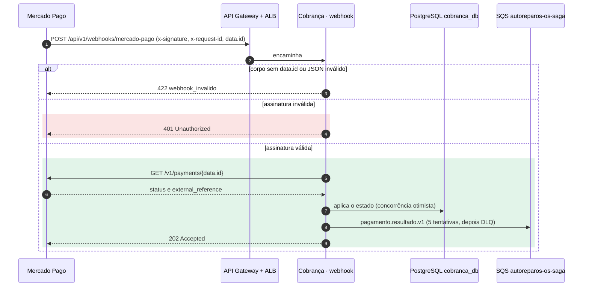

A assinatura é verificada como o Mercado Pago define: do cabeçalho `x-signature` (`ts=...,v1=...`) monta-se o manifesto `id:{data.id em minúsculas};request-id:{x-request-id};ts:{ts};`, calcula-se o HMAC-SHA256 com `MercadoPago__WebhookSecret` e compara-se com `v1` em tempo constante. Sem segredo configurado, toda notificação é recusada.

| Status no Mercado Pago | Status do pagamento | Efeito na Saga |
| --- | --- | --- |
| `approved` | `Capturado` | `PagamentoCapturado` e OS `Paga` |
| `rejected` | `Rejeitado` | só registro; nova tentativa de checkout possível |
| `cancelled` | `Cancelado` | só registro; nova tentativa de checkout possível |
| `pending`, `in_process` | `Pendente` | só registro |
| `refunded`, `charged_back` | `Reembolsado` | só registro |
| outro | — | `422 pagamento_provedor_invalido` |

- **Idempotência:** notificação repetida para o mesmo estado e referência já publicados responde `202` sem novo efeito; o `eventId` de `pagamento.resultado.v1` é determinístico por pagamento + status + referência.
- **Recuperação para frente:** se a publicação falhar, o estado fica gravado, o alerta `billing.payment_sync_failed` é emitido e o webhook responde `503 resultado_nao_publicado`; a reentrega do Mercado Pago republica.
- **Em produção:** o checkout de ponta a ponta com webhook automático foi validado em 17/11/2026 (aplicação de teste em modo produtivo): pagamento aprovado → notificação `202` → Saga `PagamentoCapturado` → OS `Paga`.

### Reembolso

Fora da Saga e nunca automático (D-09). Em duas fases: (1) reserva o reembolso como `Pendente`, já contando no limite acumulado; (2) chama o Mercado Pago e confirma. Falha definitiva (`4xx` que não seja `408`/`429`) desfaz a reserva; desfecho incerto mantém a reserva para retomada com a mesma referência e alerta `billing.refund_outcome_unknown`. Quando os reembolsos confirmados somam o valor total, o pagamento vira `Reembolsado`.

---

## Mensageria

Envelope JSON em camelCase com `eventId` (estável em reenvios), `tipo`, `ordemServicoId`, `ocorreuEm` (UTC, ISO 8601), os campos do `tipo` e, opcionalmente, `traceparent`/`tracestate` (W3C, D-65). `correlacaoId` só aparece nas respostas ao comando de cancelamento (ecoado do comando). O contrato completo está em [`saga-mensageria/contracts.md`](https://github.com/Grupo78-PosTech-15SOAT/AutoReparos/blob/main/.specs/features/fase4/saga-mensageria/contracts.md) do repositório principal.

```json
{
  "eventId": "6f1c2a3e-0b7d-4c55-9a1e-2d8f4b6c7a90",
  "tipo": "orcamento.aprovado.v1",
  "ordemServicoId": "b3d5f7a1-1c2e-4f60-8a9b-0c1d2e3f4a5b",
  "ocorreuEm": "2026-11-17T19:10:00Z",
  "orcamentoId": "0a1b2c3d-4e5f-4a6b-8c7d-9e0f1a2b3c4d",
  "clienteId": "5e6f7a8b-9c0d-4e1f-a2b3-c4d5e6f7a8b9",
  "itens": [{ "insumoId": "1f2e3d4c-5b6a-4978-8a9b-0c1d2e3f4a5b", "quantidade": 2 }],
  "traceparent": "00-4bf92f3577b34da6a3ce929d0e0e4736-00f067aa0ba902b7-01"
}
```

### Mensagens publicadas (fila de entrada da Saga `autoreparos-os-saga`, `Sqs__QueueUrl`)

| `tipo` | Quando | Campos extras | Como sai |
| --- | --- | --- | --- |
| `orcamento.aprovado.v1` | O cliente aprova o orçamento | `orcamentoId`, `clienteId`, `itens` (só insumos, somados por insumo; lista vazia quando não há insumos) | Outbox |
| `pagamento.resultado.v1` | O webhook muda o estado do pagamento | `pagamentoId`, `status`, `referencia` | Direto, com retry e DLQ |
| `orcamento.cancelado.v1` | Comando de cancelamento aceito | `orcamentoId`, `correlacaoId` | Outbox |
| `orcamento.cancelamento-recusado.v1` | Comando recusado ou inválido | `orcamentoId`, `motivo`, `correlacaoId` | Outbox |

### Comando consumido (`autoreparos-cobranca-comandos`, `Sqs__ComandosQueueUrl`)

| `tipo` | Campos | Efeito |
| --- | --- | --- |
| `cobranca.cancelar-orcamento.v1` (aceita também o alias legado de entrada `billing.orcamento.cancelar.v1`) | `eventId`, `ordemServicoId`, `orcamentoId`, `motivo`, `correlacaoId` | Cancela o orçamento `Pendente`, ou `Aprovado` sem pagamento iniciado; recusa com `pagamento_existente` ou `orcamento_recusado` |

### Filas e garantias

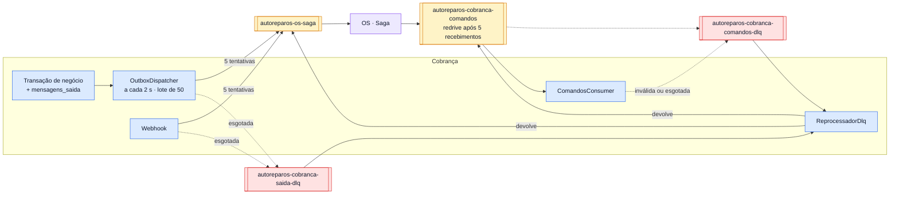

| Fila | Dona | Uso |
| --- | --- | --- |
| `autoreparos-os-saga` | OS | Destino de tudo que a Cobrança publica para a Saga |
| `autoreparos-cobranca-saida-dlq` | Cobrança | Mensagens publicadas que esgotaram as tentativas (`Sqs__DeadLetterQueueUrl`) |
| `autoreparos-cobranca-comandos` | Cobrança | Comandos da Saga (visibilidade 90 s, retenção 4 dias, long polling 20 s) |
| `autoreparos-cobranca-comandos-dlq` | Cobrança | Comandos inválidos ou esgotados (retenção 14 dias) |
| `autoreparos-cobranca-execucoes` (+ DLQ) | Cobrança | Criada para `execucao.concluida.v1`, sem consumidor (D-59); a Execução passou a publicar por SNS (D-67) |

- **Outbox:** `orcamento.aprovado.v1` e as respostas de cancelamento são gravados em `mensagens_saida` na mesma transação do fato de negócio. O `OutboxDispatcher` publica em ordem de criação e, ao iniciar, retoma as pendentes. A aprovação HTTP responde `200` mesmo com o SQS fora do ar.
- **Retry:** 5 tentativas com backoff exponencial (100 ms × 2^(n−1), teto de 5 s) e jitter de até 100 ms. Esgotadas, a mensagem vai à DLQ com o alerta `billing.sqs.exhausted` (`billing.sqs.dlq_failed` se nem a DLQ aceitar; nesse caso ela continua pendente). No consumo de comandos, cada tentativa usa um escopo novo; esgotadas, alerta `billing.comando.esgotado` e DLQ de comandos (`billing.comando.dlq_failed` se a DLQ falhar, e a mensagem volta à fila).
- **Entrega pelo menos uma vez:** o `eventId` é estável e o OS deduplica; a Cobrança deduplica os comandos em `eventos_processados`.
- **Reprocessamento:** `POST /api/v1/admin/dlq/reprocessar` devolve a DLQ de comandos à fila de comandos e a DLQ de saída à fila da Saga; a mensagem só sai da DLQ depois de reenviada, e a ação gera o alerta `billing.dlq-reprocessada` com o autor.

---

## Banco de dados

PostgreSQL próprio: database `cobranca_db`, usuário `cobranca_app`, na instância RDS compartilhada da plataforma (D-05). Nenhum outro serviço acessa esse banco; o OS e a Execução são consultados pelas APIs deles.

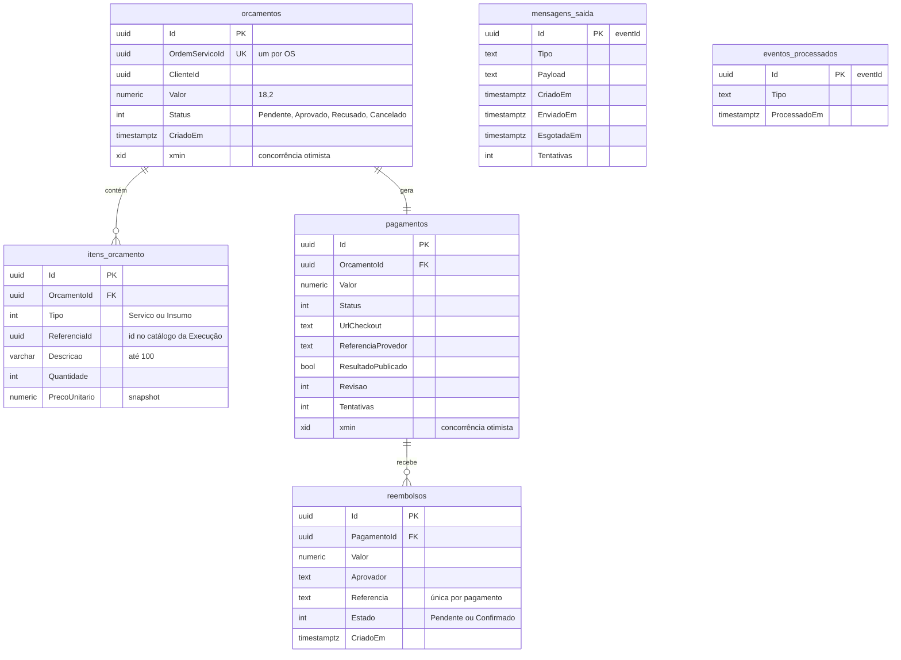

Migrations (escritas à mão, sem model snapshot, em `AutoReparos.Cobranca.Infrastructure/Migrations`): `202611090001_InitialBilling`, `202611100001_AddPagamentoRevisao`, `202611110001_AddReembolsoEstado`, `202611120001_AddPagamentoTentativas`, `202611130001_AddMensageriaSaga` (outbox e inbox) e `202611150001_AddItensOrcamento`. Em produção rodam no Job Helm `cobranca-migracao` (`Database__RunMigrations=true`: aplica e encerra); o chart liga `Database__SkipStartupMigration=true` para o pod não migrar na inicialização. Fora do cluster, o serviço aplica as migrations ao iniciar.

---

## Observabilidade

Mesma stack da Fase 3 (OpenTelemetry Collector, Prometheus, Grafana, Loki e Jaeger, no namespace `autoreparos`). Traces, métricas e logs saem por OTLP para `Telemetry__OtlpEndpoint`, com `service.name` `autoreparos-cobranca` no cluster.

| Sinal | Instrumentação |
| --- | --- |
| Traces | ASP.NET Core, HttpClient (Mercado Pago, OS, Execução) e `ActivitySource("AutoReparos.Cobranca.Mensageria")`: span `Producer` "publicar {tipo}" e `Consumer` "processar {tipo}", com `messaging.system`, `messaging.message.id` e `ordem_servico.id`. O `traceparent` gravado no envelope (também nas mensagens do outbox) liga o trace da Cobrança ao da Saga no OS |
| Métricas | ASP.NET Core, HttpClient e runtime .NET |
| Logs | OTLP com escopos; alertas como logs críticos `ALERTA {Codigo}` |

| Alerta | Quando |
| --- | --- |
| `billing.sqs.exhausted` / `billing.sqs.dlq_failed` | Publicação esgotada (foi à DLQ) / nem a DLQ aceitou |
| `billing.outbox.nao_configurado` | Filas do outbox não configuradas |
| `billing.payment_sync_failed` | Falha ao publicar `pagamento.resultado.v1` |
| `billing.comando.*` | Comando inválido, divergente, esgotado ou sem DLQ |
| `billing.mercadopago.checkout_failed` / `reconciliation_failed` / `refund_failed` | Mercado Pago indisponível após as tentativas |
| `billing.os_service.readiness_failed` / `cobranca.execucao.catalogo_failed` | OS ou Execução indisponíveis após as tentativas |
| `billing.refund_outcome_unknown` / `billing.refund_compensation_failed` | Desfecho incerto ou falha ao desfazer a reserva de reembolso |
| `billing.dlq-reprocessada` | Reprocessamento das DLQs, com o autor |

---

## Como rodar localmente

Pré-requisitos: **.NET SDK 10** e **Docker** (os testes de integração sobem PostgreSQL 16 com Testcontainers).

```bash
dotnet restore AutoReparos.Cobranca.slnx
dotnet build AutoReparos.Cobranca.slnx -m:1
dotnet test AutoReparos.Cobranca.Tests
dotnet format AutoReparos.Cobranca.slnx --verify-no-changes --no-restore
```

Para subir a API apontando para um PostgreSQL local:

```bash
docker run -d --name cobranca-postgres -p 5432:5432 \
  -e POSTGRES_DB=cobranca_db -e POSTGRES_USER=cobranca_app -e POSTGRES_PASSWORD='<senha-local>' postgres:16-alpine

export ConnectionStrings__Billing='Host=localhost;Port=5432;Database=cobranca_db;Username=cobranca_app;Password=<senha-local>'
export Authentication__Authority='<URL do emissor OIDC (Cadastros)>'
export Authentication__Audience='autoreparos'
export OsService__BaseUrl='<URL do OS>'
export Execucao__BaseUrl='<URL da Execução>'
export AWS_REGION=us-east-1

dotnet run --project AutoReparos.Cobranca.Api   # aplica as migrations e sobe em http://localhost:5134
```

Sem as filas, a API funciona e o despachador do outbox só alerta (`billing.outbox.nao_configurado`), mantendo as mensagens pendentes; sem `Sqs__ComandosQueueUrl` o consumo de comandos fica desativado. Sem `MercadoPago__AccessToken` o checkout responde erro de integração e, sem `MercadoPago__WebhookSecret`, todo webhook é recusado. Credenciais AWS vêm da cadeia padrão do SDK, nunca do repositório.

Imagem: `docker build -t autoreparos-cobranca .` (porta 8080).

---

## Testes

`AutoReparos.Cobranca.Tests` (xUnit, `Microsoft.AspNetCore.Mvc.Testing`, Testcontainers PostgreSQL 16, exportador OpenTelemetry em memória) — **111 testes no CI**:

| Arquivo | O que cobre |
| --- | --- |
| `BillingLifecycleTests` | Ciclo orçamento → aprovação → checkout → webhook → reembolso, autorização por papel e dono |
| `BillingHardeningTests` | Concorrência otimista, retry e timeout das dependências, assinatura do webhook, idempotência do checkout, limites de valor, reembolso em duas fases |
| `BillingMensageriaTests` | Outbox, envelopes, cancelamento por comando, deduplicação, retry, DLQ e alertas |
| `BillingContratoOsTests` | Contrato com a Saga do OS, com os payloads de referência |
| `OrcamentoSnapshotTests` / `OrcamentoAprovadoItensTests` | Preço congelado dos itens e itens da reserva no `orcamento.aprovado.v1` |
| `ReprocessaDlqTests` | Reprocessamento das DLQs |
| `TraceMensageriaTests` | Propagação do contexto W3C nos envelopes e spans |
| `SaudeEndpointTests`, `MigrarESairTests`, `MigracaoNaInicializacaoTests`, `CredenciaisIrsaTests` | `/health`, migrations por Job e no startup, credenciais IRSA |

O BDD do fluxo completo fica no OS (D-63): os 6 cenários Reqnroll de `AutoReparos.OS.BddTests` simulam as mensagens que a Cobrança envia (`orcamento.aprovado.v1`, `pagamento.resultado.v1` com `Capturado` ou `Rejeitado`, `orcamento.cancelado.v1`), no mesmo contrato verificado aqui por `BillingContratoOsTests`.

---

## Cobertura e qualidade

O limite mínimo é de **80% de cobertura de linhas** por serviço, verificado no CI.

| Evidência | Valor |
| --- | --- |
| Último run da `main` ([#44153969807](https://github.com/Grupo78-PosTech-15SOAT/AutoReparos.Cobranca/actions/runs/44153969807), commit `72a4ed6`, 17/11/2026) | **95,65%** de linhas (770 de 805) — `build`, `test`, `quality` e `deploy` verdes |
| Testes do mesmo run | 111 aprovados, 0 falhas |
| SonarCloud (quality gate e cobertura atuais) | https://sonarcloud.io/project/overview?id=Grupo78-PosTech-15SOAT_AutoReparos.Cobranca |

Como funciona:

- O job `test` roda `AutoReparos.Cobranca.Tests` com `XPlat Code Coverage` (formatos Cobertura e OpenCover, excluindo `Migrations` e `obj`).
- `.github/scripts/verificar_cobertura.py TestResults --minimo 80` une os relatórios `coverage.cobertura.xml` e **reprova o pipeline abaixo de 80%** (`MINIMO_COBERTURA`).
- O job `quality` envia os relatórios OpenCover e os `.trx` ao SonarCloud (projeto `Grupo78-PosTech-15SOAT_AutoReparos.Cobranca`, organização `grupo78-postech-15soat`) e espera o quality gate; `bin`, `obj` e `Migrations` ficam fora da análise.

---

## CI/CD e deploy

O pipeline [`.github/workflows/ci-cd.yml`](.github/workflows/ci-cd.yml) é independente dos demais serviços e roda em pull request e push para `main` e `develop` e por `workflow_dispatch`.

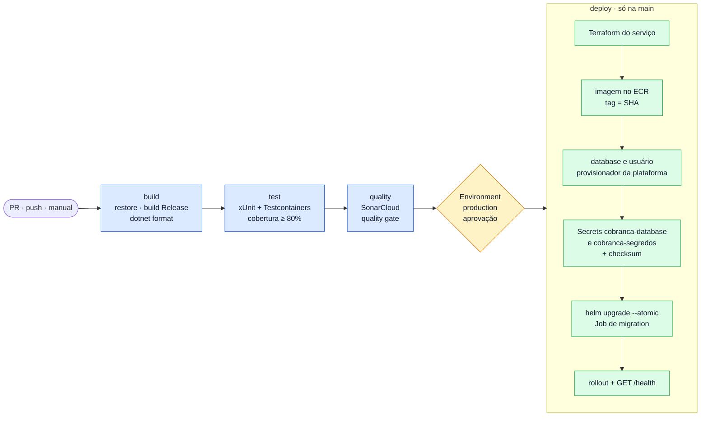

| Job | Quando | O que faz |
| --- | --- | --- |
| `build` | sempre | `dotnet restore`, `dotnet build -c Release` e `dotnet format --verify-no-changes` |
| `test` | depois do `build` | Testes com cobertura mínima de 80% e artefato com os resultados |
| `quality` | push na `main` ou PR para a `main` | SonarCloud com quality gate; falha de propósito sem `SONAR_TOKEN` |
| `deploy` | push ou disparo manual na `main`, após os três anteriores | Environment `production` (aprovação obrigatória de revisor e deploy só pela `main`): Terraform, imagem no ECR, database pelo provisionador `autoreparos-provisionador-db` (chamada assinada SigV4), Secrets, `helm upgrade --install --atomic` e verificação de rollout e `GET /health` |

Os jobs `build` e `test` (e o `quality`) são os checks previstos para a proteção da `main` (D-25).

### Segredos do Mercado Pago e reinício automático do pod

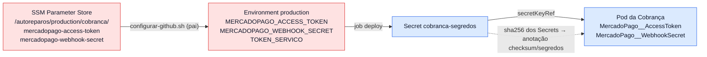

O job `deploy` calcula o SHA-256 dos Secrets `cobranca-database` e `cobranca-segredos` e o passa ao chart como a anotação `checksum/segredos` do pod: trocar só um segredo (sem imagem nova) também recria o pod, que passa a ler o valor novo. As credenciais do Mercado Pago e o token de serviço são opcionais no chart; quando faltam, o job emite um aviso e o serviço sobe assim mesmo.

### Infraestrutura do serviço

| Onde | Recursos |
| --- | --- |
| `infra/terraform/` | ECR `autoreparos-cobranca` (scan no push, guarda as 10 imagens mais recentes); filas `autoreparos-cobranca-comandos`, `autoreparos-cobranca-execucoes`, `autoreparos-cobranca-saida-dlq` e as DLQs (SSE gerenciada); role IRSA `autoreparos-cobranca-irsa` com permissions boundary (consome as próprias filas e só publica em `autoreparos-os-saga`); segredo `autoreparos/production/cobranca/database` no Secrets Manager. Lê a plataforma pelo SSM `/autoreparos/production/*` (D-53). Teste em `infra/terraform/tests/recursos.tftest.hcl` |
| `deploy/helm/cobranca/` | `Deployment` (1 réplica, `securityContext` sem root, probes em `/health`, anotação `checksum/segredos`), `Service` ClusterIP 8080, `HorizontalPodAutoscaler` (1 a 3 réplicas, CPU 80%), `Ingress` no ALB interno compartilhado, `ServiceAccount` com IRSA e `Job` de migration (`pre-install,pre-upgrade`) |
| `Dockerfile` | Build multi-stage (`dotnet/sdk:10.0` → `dotnet/aspnet:10.0`), porta 8080 |

### Segredos e variáveis do repositório (só nomes)

| Nome | Tipo | Uso |
| --- | --- | --- |
| `SONAR_TOKEN` | secret | Análise no SonarCloud (obrigatório para o `quality`) |
| `SONAR_ORGANIZATION` / `SONAR_PROJECT_KEY` | variables (opcionais) | Padrões `grupo78-postech-15soat` e `Grupo78-PosTech-15SOAT_AutoReparos.Cobranca` |
| `AWS_ROLE_ARN` | variable do Environment `production` | Role OIDC assumida pelo `deploy` |
| `TF_STATE_BUCKET` / `TF_LOCK_TABLE` | variables do Environment `production` | Backend do Terraform |
| `MERCADOPAGO_ACCESS_TOKEN` / `MERCADOPAGO_WEBHOOK_SECRET` | secrets do Environment `production` | Credenciais do Checkout Pro e assinatura do webhook (origem: SSM) |
| `TOKEN_SERVICO` | secret do Environment `production` | JWT de serviço para chamar o OS e a Execução (D-58) |

---

## Configuração

Todas as configurações vêm de variáveis de ambiente (ou de Secrets do Kubernetes); nenhum valor sensível é versionado.

| Variável | Uso | Padrão / produção |
| --- | --- | --- |
| `ConnectionStrings__Billing` | Conexão com `cobranca_db` | Secret `cobranca-database` |
| `Authentication__Authority` / `Authentication__Audience` | Emissor do JWT (Cadastros, via API Gateway) e audiência | URL do gateway / `autoreparos` |
| `MercadoPago__AccessToken` | Access Token do Mercado Pago | Secret `cobranca-segredos` |
| `MercadoPago__WebhookSecret` | Assinatura secreta do webhook | Secret `cobranca-segredos` |
| `OsService__BaseUrl` / `OsService__BearerToken` | OS consultado antes do checkout | `http://os.os.svc.cluster.local:8080` / Secret `cobranca-segredos` |
| `Execucao__BaseUrl` / `Execucao__BearerToken` | Catálogo de preços da Execução | `http://execucao.execucao.svc.cluster.local:8080` / Secret `cobranca-segredos` |
| `AWS_REGION` | Região AWS | `us-east-1` |
| `Sqs__QueueUrl` | Fila de entrada da Saga (destino das publicações) | `autoreparos-os-saga` |
| `Sqs__DeadLetterQueueUrl` | DLQ das publicações | `autoreparos-cobranca-saida-dlq` |
| `Sqs__ComandosQueueUrl` / `Sqs__ComandosDeadLetterQueueUrl` | Fila de comandos da Saga e sua DLQ | `autoreparos-cobranca-comandos` / `autoreparos-cobranca-comandos-dlq` |
| `Outbox__IntervaloMs` | Intervalo do despachador do outbox | `2000` |
| `Telemetry__ServiceName` / `Telemetry__OtlpEndpoint` | Nome do serviço e coletor OTLP | `autoreparos-cobranca` (padrão do código: `autoreparos-billing`) / coletor do namespace `autoreparos` |
| `Database__RunMigrations` | Aplica as migrations e encerra (Job Helm) | `true` só no Job |
| `Database__SkipStartupMigration` | Não migra na inicialização | `true` no cluster |

---

## Repositórios do projeto

| Repositório | Papel |
| --- | --- |
| [AutoReparos](https://github.com/Grupo78-PosTech-15SOAT/AutoReparos) | Repositório principal: plataforma (rede, EKS, RDS, API Gateway), especificação e documentação de entrega |
| [AutoReparos.OS](https://github.com/Grupo78-PosTech-15SOAT/AutoReparos.OS) | Ordens de serviço e orquestrador da Saga |
| [AutoReparos.Cobranca](https://github.com/Grupo78-PosTech-15SOAT/AutoReparos.Cobranca) | **Este serviço**: orçamento, aprovação, Mercado Pago e reembolso |
| [AutoReparos.Execucao](https://github.com/Grupo78-PosTech-15SOAT/AutoReparos.Execucao) | Fila de execução, etapas, catálogo e reserva de insumos |
| [AutoReparos.Cadastros](https://github.com/Grupo78-PosTech-15SOAT/AutoReparos.Cadastros) | Clientes, veículos, usuários e emissão do JWT |
| [AutoReparos.Web](https://github.com/Grupo78-PosTech-15SOAT/AutoReparos.Web) | Frontend Angular |
| [AutoReparos.AuthLambda](https://github.com/Grupo78-PosTech-15SOAT/AutoReparos.AuthLambda) | Autenticação do cliente por CPF |
| [AutoReparos.Infra.K8s](https://github.com/Grupo78-PosTech-15SOAT/AutoReparos.Infra.K8s) | Chart de observabilidade e do Web |
| [AutoReparos.Infra.Database](https://github.com/Grupo78-PosTech-15SOAT/AutoReparos.Infra.Database) | Infraestrutura de banco da plataforma |

Leituras complementares no repositório principal: [integração com o Mercado Pago](https://github.com/Grupo78-PosTech-15SOAT/AutoReparos/blob/main/.specs/features/fase4/especificacao/microsservicos/fase4_spec_integracao_mercado_pago.md), [especificação da Saga](https://github.com/Grupo78-PosTech-15SOAT/AutoReparos/blob/main/.specs/features/fase4/especificacao/saga/fase4_spec_saga_pattern.md), [arquitetura final e justificativa](https://github.com/Grupo78-PosTech-15SOAT/AutoReparos/blob/main/docs/entrega/fase4/arquitetura_e_justificativa.md) e [contrato de mensagens da Saga](https://github.com/Grupo78-PosTech-15SOAT/AutoReparos/blob/main/.specs/features/fase4/saga-mensageria/contracts.md).
